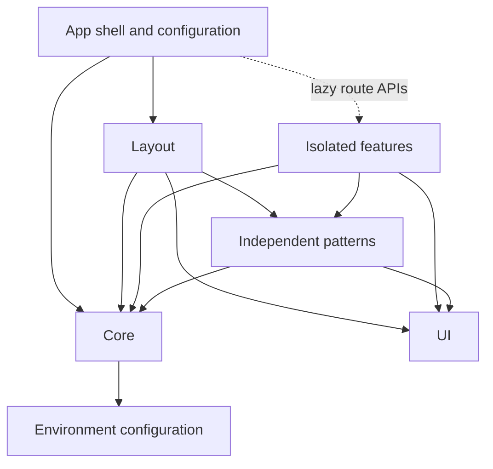

# Application architecture

This application adapts Tomas Trajan's Angular Enterprise Architecture to a single Angular
22 application. Feature folders are boundaries, not independent packages. Keep the Angular
CLI workspace; introduce libraries only when separate consumers or ownership justify them.

## Placement and dependency direction

| Location                     | Responsibility                                                    | Allowed local dependencies                                                   |
| ---------------------------- | ----------------------------------------------------------------- | ---------------------------------------------------------------------------- |
| `src/app/app*.ts`            | Root shell, route composition, browser/server configuration       | Other app files, core, layout; feature route APIs through dynamic imports    |
| `core/`                      | Headless shared services, auth, models, guards, startup providers | Core, environments                                                           |
| `layout/`                    | Application shell connected to shared state                       | Layout, core, UI, patterns                                                   |
| `ui/`                        | Reusable presentation components, directives, pipes               | UI                                                                           |
| `pattern/<name>/`            | Reusable application-specific presentation or workflows           | Own implementation, core, UI                                                 |
| `feature/<name>/`            | A lazy page or workflow and its private implementation            | Own implementation, core, UI, patterns, environments                         |
| `feature/<name>/*.routes.ts` | Public routing API of a lazy feature                              | Feature dependencies above; other feature route APIs through dynamic imports |

The same import rules apply to colocated tests. Unknown application files and unresolved
local imports fail lint. Browser application code cannot import `src/server/`.
The architecture rules cover `src/app/**/*.ts`; backend internals and Supabase functions
have their own tests and are outside this Angular dependency taxonomy.



Shared implementation never comes from another feature. For example, home and the archive
both consume `pattern/past-events`. That pattern understands the event domain and event
navigation, so it belongs in `pattern`, while the date formatting pipe belongs in `ui`.
The toast outlet belongs in `layout` because it connects the app shell to `ToastService`.

## Lazy features are black boxes

The app router owns public URL prefixes and cross-feature access guards. Each feature
exposes a route array and owns its components, local services, and internal routes:

```ts
{
  path: 'events',
  loadChildren: () =>
    import('./feature/past-events/past-events.routes').then((m) => m.PAST_EVENTS_ROUTES),
}
```

Only top-level `*.routes.ts` files in a feature are public entry points. Other features
may compose them lazily from their own route entry points, as submit-talk does with
submit-talk-success. Static imports, re-exports, and type imports cannot bypass feature
isolation. Within a feature, choose `component` or `loadComponent` based on whether another
chunk boundary helps; the dashboard shell can remain a direct import in its lazy routes.

Feature-local services stay in that feature. Root DI scope does not by itself make a
service eager: the importing dependency graph determines what enters the initial bundle.
Move headless logic to `core` when it is needed at startup or shared by multiple consumers.
Use `pattern` for shared domain-aware presentation and `ui` for independent presentation.
Avoid aggregate feature barrels that accidentally make implementation public.

## Startup and SSR

`provideCore({ routes })` owns common startup providers: error listeners, hydration,
router configuration and authentication initialization. It accepts routes rather than
importing the app router, preserving the dependency direction. Server-only rendering
configuration remains in `app.config.server.ts` and `app.routes.server.ts`.

The route-entry refactor preserves URL paths, route guards, rendering modes, and component
input binding. Router integration tests exercise event slug inheritance, archive titles,
and callback-to-login navigation through the additional lazy route level.

## Automated validation

`eslint.config.js` uses `eslint-plugin-boundaries` with a TypeScript resolver and default-deny
local dependency policies. It checks imports, re-exports, `require`, and dynamic imports.
The installed plugin uses the current `boundaries/dependencies` rule and `policies` syntax
instead of the older `element-types` examples in the book.

```bash
npm run lint
npm run test:architecture
npm test -- --watch=false
npm run build:development
```

`scripts/architecture.spec.mjs` verifies both allowed and rejected imports using the actual
ESLint configuration. CI runs these tests alongside application linting, unit tests, and
the production build. Add an enforcement case whenever the dependency policy changes.

## Future refactoring

The broad `SupabaseService` remains a candidate for domain-oriented services, such as
events and talk submissions, as those workflows grow. Split it around cohesive use cases
with existing behavior tests; avoid adding pass-through facades solely to rename the same
large API. Shared model files can likewise move into domain folders when that improves
navigation. Neither change is required to enforce the current feature boundaries.

## References

- [Local architecture skill and book extracts](../.agents/skills/enterprise-architecture/SKILL.md)
- [JS Boundaries dependency policies](https://www.jsboundaries.dev/docs/rules/dependencies/)
